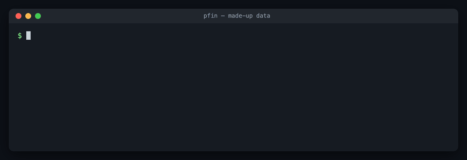

# Personal Finance（pfin）

[English](README.md) · 简体中文

**本地优先、只读的个人记账命令行工具：把支付宝、微信支付、银行短信、花呗和淘宝 / 京东 / 携程订单合成一本账，
一笔钱只算一次，为 AI 代理而设计。**

[](https://github.com/risingjerry/personal-finance/actions/workflows/ci.yml)
[](LICENSE)




一笔钱在你手机里会被看到好几次：微信账单一行、银行 App 一行、一条支付通知、淘宝一张订单。
**pfin 把这些记录原样留作证据，再合成真实发生的事件，一笔钱只算一次**，然后按你写的规则分到个人、生意、投资几本账。

- **本地优先**：所有数据在你 Mac 上的一个私有目录，不上传任何服务。
- **只读**：只读账单和通知，没有任何命令能付款、转账、取消或改设置。
- **缺了就是缺了**：拿不到的数字不填 0，对不上的列出来给你看。
- **给 AI 代理用的**：输出 JSON，规则是普通 JSON 文件，退出码固定。代理帮你采集、对账，你只做决定。

<details><summary>同样的演示（文字版）</summary>

```console
$ python3 -m pfin demo
6 records -> 4 events

01-05 20:15  purchase    129.00  某数码旗舰店  <- alipay-transaction + taobao-order
01-08 12:30  p2p         200.00  张三          <- alipay-transaction
01-09 09:00  internal    300.00  花呗          <- alipay-transaction
01-14 12:00  purchase    420.00  某酒店        <- ctrip-naquhua-bill + ctrip-order

personal: internal 300.00  p2p 200.00  purchase 549.00
needs your decision: 某酒店 420.00, 张三 200.00, 某数码旗舰店 129.00
```

</details>

支付宝那笔付款和淘宝订单是同一次消费；携程酒店订单和两天后拿去花的账单是同一次消费；花呗还款是自己账户之间的钱，
不算花销；转给张三的钱等你说一句归哪本账。

## 快速开始

需要 Python 3.11+（只用标准库）。连接器和采集器只支持 macOS；合并引擎哪里都能跑。

```bash
git clone https://github.com/risingjerry/personal-finance.git
cd personal-finance
python3 -m pfin demo                      # 编造的数据，放在临时目录，不碰任何真实数据
```

你会看到 `6 records -> 4 events`，后面是上面演示里那四笔合并后的事件。

用你自己的数据（私有目录 `PFIN_HOME`，默认 `~/Library/Application Support/personal-finance`）：

```bash
RAW=~/Library/Application\ Support/personal-finance/raw
python3 -m connectors.alipay login                         # 扫一次码（支付宝连接器需要 Node 22 和 Chrome）
python3 -m connectors.alipay fetch --sync --out "$RAW/alipay"
python3 -m connectors.taobao fetch --out "$RAW/taobao"     # 先在浏览器里登录淘宝
python3 -m pfin import
python3 -m pfin resolve --from 2026-09-01 --to 2026-09-30
python3 -m pfin coverage                                   # 每个账户由哪份账单覆盖哪些日子，哪里有缺口
```

跑通之后，在 `config.json` 的 `"sync"` 里列出要定时拉的连接器，`python3 -m pfin sync --install` 就会自动保持更新（见 [`docs/RULES.md`](docs/RULES.md)）。

导出的文件也行：把微信支付账单（`.xlsx`，需要 `openpyxl`）放进 `raw/wechat/`，再 `python3 -m pfin import`。

## 能读什么

| 类别 | 来源 |
|---|---|
| 支付账单 | 微信支付账单导出、支付宝官方账单导出（多账号）、支付宝商家余额流水（开放平台接口） |
| 银行和信用 | Mac 上的银行短信；手机读屏得到的银行卡、信用卡、花呗、美团月付列表 |
| 购物和出行 | 淘宝、京东（含白条）、携程（含拿去花）、美团月付、大众点评、闲鱼、滴滴、12306 |
| 加密货币交易所 | OKX（C2C + API）、币安、Bitget，只进投资账 |

每个平台是一个**连接器**：`connectors/` 下一个只读的小命令行工具，五个动作都一样。

| 命令 | 作用 |
|---|---|
| `python3 -m connectors.<名字> manifest` | 这个连接器是什么（JSON） |
| `python3 -m connectors.<名字> status [--online]` | 登录在不在、平台还认不认 |
| `python3 -m connectors.<名字> login` | 登录一次，扫码或验证码由你完成 |
| `python3 -m connectors.<名字> fetch --out 目录` | 原始 JSON + 统一格式的 `<名字>-rows-<时间>.jsonl` |
| `python3 -m connectors.<名字> keepalive` | 发一次轻量只读请求，让登录别过期 |

网页登录的连接器从你自己的 Chromium 系浏览器读 Cookie（Chrome、Edge、Brave、Arc、Dia；用 `PFIN_BROWSER=chrome`
指定），读的是只读副本，只放在内存里。API Key 按名字从环境变量、macOS 钥匙串（服务名 `pfin`）或你在 `~/.config/pfin/secrets.json` 里配置的密码管理命令读。
写一个新连接器见 [`docs/CONNECTORS.md`](docs/CONNECTORS.md)。

## 框架命令

| 命令 | 作用 |
|---|---|
| `pfin demo` | 用一个月的编造记录在临时目录里演示合并 |
| `pfin import` / `pfin rebuild` | 把 `raw/` 里的新文件导入证据库（重复导入不会重复）/ 从头重建 |
| `pfin resolve --from --to` | 合成事件，按账本汇总，列出等你决定的对方 |
| `pfin coverage` | 每个账户由哪份账单覆盖哪些日子 |
| `pfin sources` | 每个数据集的角色，以及不进合并的原因 |
| `pfin invest` | 投资账：充提、合约结果、资金费、理财收益 |
| `pfin sync [--install]` | 完整更新一轮；`--install` 装上**唯一的**定时任务，每 10 分钟跑一次 |
| `pfin connectors` / `status` / `login` | 所有连接器、拉取节奏和登录状态 |

在仓库目录里用 `python3 -m pfin <命令>` 运行。

## 怎么做到的

1. **记录**按来源给的样子原样保存（`raw/` 永远不改），按来源的单号去重。
2. **四轮合并**：支付通道（微信、支付宝）建事件 → 银行卡和信用账户作为资金挂上 → 通知和短信作为信号挂上 →
   订单作为明细挂上。优先级高的账单覆盖它自己的日期范围。
3. **规则**决定每个事件进哪本账：逐笔覆盖 > 有顺序的规则 > 账户默认 > 个人。分期借款的还款拆成本金（自己账户互转）和利息。

详见 [`docs/ONTOLOGY.md`](docs/ONTOLOGY.md)（模型和已知的数据坑）、[`docs/RULES.md`](docs/RULES.md)（配置、规则、逐笔决定）、
[`docs/SOURCES.md`](docs/SOURCES.md)（每个数据源）。

## 配合 Claude Code、Codex 等 AI 代理使用

仓库自带给代理看的说明：[`AGENTS.md`](AGENTS.md)（Claude Code 通过 `CLAUDE.md` 读同一份）和一个可移植的技能
[`skills/pfin/SKILL.md`](skills/pfin/SKILL.md)。

```bash
npx skills add risingjerry/personal-finance      # 或者把 skills/pfin 复制到 ~/.claude/skills/
```

然后直接说：

- "上个月我花了多少，按账本分开，还有哪些要我决定的？"
- "拉一下京东订单，看看哪些找不到对应的付款。"
- "9 月哪些天没有银行卡的账单覆盖？"

## 限制

- 连接器和采集器只支持 macOS（钥匙串、launchd、短信数据库、Chromium Cookie 解密）。
- 平台会改页面。连接器碰到风控签名会停下来告诉你，绝不伪造签名。
- 微信聊天里的支付通知需要另一个本机微信读取工具，不在本仓库里（`pfin.collectors.wechat_*`）。微信支付账单导出不受影响。
- 金额按人民币算；投资账按数量列出币种，不估价。

## 常见问题

**支付宝和微信账单怎么合并、不重复算？**
把两边的导出（或连接器输出）都放进 `raw/`，运行 `pfin resolve`。说的是同一笔钱的记录会合成一个事件，
`events_seen_in_2plus_sources` 告诉你对上了多少笔。

**能把淘宝、京东、携程的订单导出成 JSON 吗？**
能：`python3 -m connectors.taobao fetch --out ./out`（`jd`、`ctrip` 同理），会写出原始页面和每张订单一行的 JSONL。

**要我的密码吗？会上传数据吗？**
不要，也不会。登录是你自己扫码或填验证码。从浏览器读的 Cookie 只在内存里；支付宝、OKX、滴滴、12306 这几个工具把自己的登录状态存在你主目录下的私有文件夹（权限 0700/0600）。除了向平台本身发请求，数据不离开本机。

**让 AI 代理来跑安全吗？**
所有命令都是只读的、输出 JSON。密钥不会被打印、写日志或放进命令行参数。

## 卸载

删掉仓库目录即可。装过定时任务的话，先运行 `python3 -m pfin sync --uninstall`。你的数据在
`~/Library/Application Support/personal-finance`（连接器自己的状态在 `~/Library/Application Support/pfin-connectors`），
删掉这两个目录才会清除；保存的登录在钥匙串里，名字是 `pfin-session`。

## 支持与参与

有问题或发现 bug，请到 [GitHub Issues](https://github.com/risingjerry/personal-finance/issues)。也欢迎写新连接器：[`CONTRIBUTING.md`](CONTRIBUTING.md)。安全问题：[`SECURITY.md`](SECURITY.md)。

各平台的名称和商标归其所有者；本项目与它们没有关联。

如果 pfin 帮你省了一晚上对表格的时间，点个 ⭐ 能让更多人找到它。

[](https://star-history.com/#risingjerry/personal-finance&Date)

## 许可

[MIT](LICENSE)
